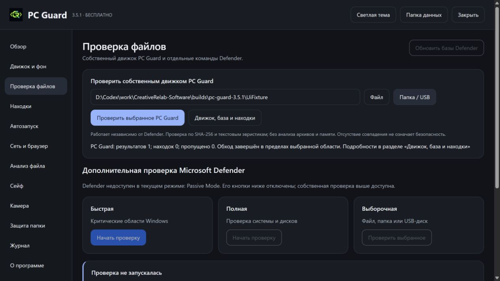

# PC Guard 3.5.1: проверка исправлений

Дата: 2026-11-09T12:40:58+03:00.
Основной EXE: `A59D9567D15537C8CE61CE540F85216D045A1269CF7C0E78FDF4CB2B859C5DC7`.

| Проверка | Результат | Доказательство |
|---|---|---|
| Данные, задания, API и валидация | 14 успешных проверок | [JSON](pc-guard-3.5.1/native.json) |
| Собственный движок, карантин, сейф и папки | 52 успешных проверок | [JSON](pc-guard-3.5.1/suite.json) |
| Нативный файл и папка с владельцем окна | 2 диалога обнаружены, владелец задан | [JSON](pc-guard-3.5.1/dialogs.json) |
| Распаковщик, Data и резервная копия | 8 проверок, 0 ошибок | [JSON](pc-guard-3.5.1/installer.json) |
| Кнопка собственного сканирования файла и папки | 2 успешных сценария на предыдущем кандидате | [JSON](pc-guard-3.5.1/ui.json) |
| Импорт SHA-256, дубли, неверный формат и контрольная сумма | 12 проверок предыдущего кандидата | [JSON](pc-guard-3.5.1/import-earlier-candidate.json) |

Нативные проверки и тесты диалогов относятся к указанному основному EXE.
Сценарии интерфейса и 12 проверок импорта относятся к отдельному кандидату 3.5.1;
их SHA указан в JSON. На финальном комплекте повторный тест чтения списка получил
отказ доступа. Причина не подтверждена. Это не засчитано как успешный импорт финального
комплекта. Парсер TXT/CSV проверен, но чтение произвольного файла базы на этом компьютере
не гарантируется. Недоступный файл должен завершать операцию явной ошибкой.

Файл и папка в тестах диалогов имели временного владельца PC Guard. Положение относительно
каждого стороннего окна и режим настоящего браузерного владельца отдельно не подтверждены.
Последующая визуальная проверка установленного окна не завершена из-за ограничения
инструмента управления браузером. Исправление использует ShowDialog(owner), общий для разделов.

На этом компьютере собственное наблюдение было настроено только на Incoming рядом с программой.
Оно проверяет файлы после изменения. Без активного системного модуля блокировки до запуска нет.
Внешние текстовые списки дополняют базу предупреждениями, JSON заменяет её. CVD ClamAV и YARA
не считаются совместимыми с этим движком. Защита всей системы и обнаружение всех угроз не заявляются.

Код и двоичный файл драйвера не изменялись. Обновление приложения сохраняет Data и резервирует
заменяемые программные файлы. Контрольные суммы исходников: [build.json](pc-guard-3.5.1/build.json).

