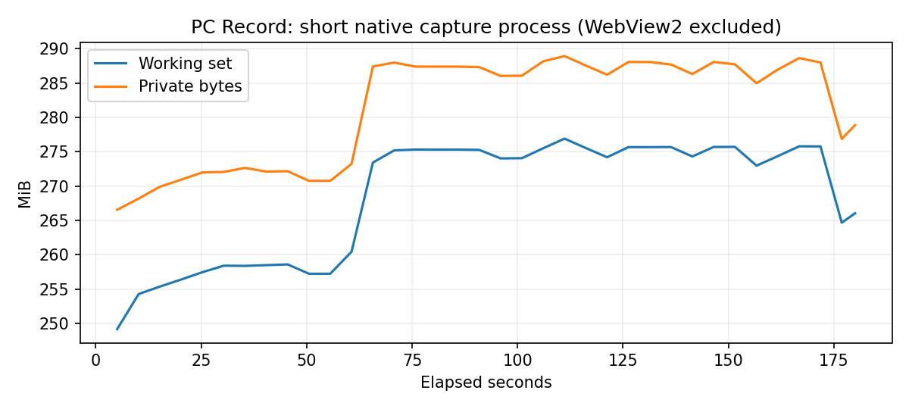

# PC Record 1.0.0: реальные результаты проверок

Дата отчёта: 2026-11-09T10:56:54+03:00. Windows build 26200.9711.
Проверенный EXE: `0E71F79AA75873D02113C90BF19AE7970D51AA96158FA5211F857E910E2CE88A`. Сборка C# 5, /warn:4 /warnaserror+, предупреждений нет.
Все программные файлы и материалы испытаний находятся на D. Изменений IObit, Defender,
драйверов, режима загрузки, настроек сна или тепловой защиты в этих работах не выполнялось.

## Проверки и происхождение результатов

| Группа | Результат | Доказательство |
|---|---|---|
| MP4/MKV, пауза, PNG, обрезка, пути | 7 pass | [JSON](pc-record-1.0.0/core.json) |
| Отсчёт, 60 FPS, разрешения, место, закрытие источника, имитация сна и разрыва таймера | 18 pass | [JSON](pc-record-1.0.0/safety.json) |
| Интерфейс, темы, сохранение параметров, редактор, библиотека, отступы списков | 18 pass | [JSON](pc-record-1.0.0/ui.json) |
| Монитор 720p, область 640×360, исключение панели | 3 pass | [JSON](pc-record-1.0.0/display.json) |
| Исходное разрешение монитора 3120×2080, MP4/MKV с полным декодированием | 2 pass | [JSON](pc-record-1.0.0/display-source.json) |
| Плавающая панель: пауза, продолжение, стоп программным вызовом | 1 pass | [JSON](pc-record-1.0.0/toolbar.json) |
| Предыдущая сборка: 1005 PNG, лимит 1000, страницы, поиск, фильтр и размер | 6 pass | [JSON](pc-record-1.0.0/library.json) |
| Системный контрольный звук, камера отдельно и оверлеем; полное декодирование | 3 pass | [JSON](pc-record-1.0.0/devices.json) |
| Предыдущая сборка: обрезка со звуком и фрагмент 1080p60 | 2 pass | [JSON](pc-record-1.0.0/media.json) |
| Предыдущий комплект исходников: сборка и базовые проверки | 7 pass | [JSON](pc-record-1.0.0/source-rebuild.json) |
| Распаковщик: целостность, Data, резервная копия, пути | 8 проверок, 0 ошибок | [JSON](pc-record-1.0.0/installer.json) |
| Общий центр обновлений, без сети | 28 проверок, 0 ошибок | [JSON](pc-record-1.0.0/updater-unit.json) |

Профиль записи: 180 секунд работы сценария, выходное видео **174.966667 с**,
36 измерений памяти и полное декодирование FFmpeg с -xerror без ошибок.
[Профиль](pc-record-1.0.0/profile.json). Отдельное сравнение кадров этого короткого теста не выполнялось.
Working set 249.2–276.9 МиБ, private bytes 266.6–288.9 МиБ.
Это процесс испытательного нативного движка, без дочерних WebView2 и без гарантии
потребления памяти на других компьютерах. Длительная стабильность этим тестом не доказана.

Аварийный тест: после 18 секунд работы принудительно завершён только собственный
тестовый процесс. Оставшийся фрагментированный MP4 **14.966667 с** прошёл
полное декодирование исходного файла без ремонта или remux.
[Результат](pc-record-1.0.0/abrupt.json). Это проверка конкретного завершения процесса,
не испытание отключения питания или отказа накопителя. Последний фрагмент может потеряться.

Контрольный системный тон: RMS 0.02403046, peak 0.04528809,
4.160 с звука. Камера и оверлей дали декодируемые видеопотоки;
субъективное качество изображения не оценивалось. Камера и аудиозаписи не публикуются.
Проверка речи микрофона пропущена по решению владельца; её успешность не подтверждена.
В первом повторе оверлей получил недоступное окно и был отклонён. Тестовый стенд
восстановил собственное окно перед захватом; повтор прошёл.
[Первый неуспешный сценарий](pc-record-1.0.0/device-first-attempt.json).

Библиотека оставлена без изменений по решению владельца. Её предыдущая проверка
успешна; повтор финальной сборки не завершён и не засчитан. JSON содержит SHA
той сборки, на которой выполнена каждая группа. Обрезка со звуком и повторный
базовый тест исходников также относятся к предыдущему комплекту. Текущие исправленные
исходники отдельно скомпилированы без предупреждений; повтор захвата этой пересборки
не выполнялся. Код интерфейса и библиотеки остался прежним.

Отрисовка библиотеки в предыдущей проверке: 20 измерений, 4.3–16.8 мс,
среднее 15.59 мс. Это время обновления DOM, не измерение физического колеса мыши.
У исключения панели остаётся зависимость от Windows; API принят, тело панели отсутствует
на тестовом захвате, системные оверлеи Windows отдельно не скрываются.

## Прерванная длительная запись

Двухчасовой тест старой сборки **не пройден**. Последний сохранённый прогресс
6343.341 с. Windows записала Kernel-Power 42, 09.11.2026 01:21:15,
причина сна Thermal Zone. После возобновления процесс отсутствовал, отчёт остался running,
а старый MP4 не читался: moov atom not found. Причину завершения процесса подтвердить
не удалось. Температуры недоступны для чтения; перегрев из-за PC Record не установлен.
[Зафиксированные обстоятельства](pc-record-1.0.0/long-interrupted.json).

По решению владельца повторный длительный прогон отложен, разрешены только короткие проверки.
Исправление: начальный заголовок и фрагменты MP4, попытка остановки при уведомлении о сне,
остановка при разрыве таймера более 30 секунд, постепенная запись измерений в JSONL.
Событие сна и разрыв таймера проверены только имитацией внутри приложения;
настоящий сон, тепловая защита и системные часы не изменялись.

## Ручные проверки и ограничения

Ctrl+F9 действительно запускала и останавливала запись. Файл из библиотеки открылся
в MPC-HC и воспроизводился, длительность 88 с. Эти ручные проверки выполнены до изменения
контейнера; SHA сборки приведён в [JSON](pc-record-1.0.0/manual-ui.json).
Физическое перетаскивание исключённой из захвата панели не подтверждено.
Внутренние кнопки проверены программными сценариями; внешние ссылки сайта и открытие
папки не входят в автоматический проход интерфейса. Не проверены все устройства,
все версии Windows, авария питания и многочасовая работа после исправления.

## Происхождение и воспроизведение

[Хеши исходников и пакетов](pc-record-1.0.0/build.json).
Базовые тесты доступны через --verify-capture, ограничения через --verify-release,
интерфейс через --verify-controls, экран через --verify-display.
Короткий профиль: PCRECORD_LONG_ONLY=1 и PCRECORD_LONG_SECONDS=180 с --verify-extended.
Для устройств используйте PCRecordDeviceChecks.cs; он не открывает микрофон.
Остальные сценарии находятся рядом в verification/PCRecord*.cs и .js.
Отдельный сценарий библиотеки готовит PCRecordPrepareLibrary.py в новой папке на D.
Сборка из исходников использовала закреплённые зависимости, проверенные SHA-256;
EXE после повторной компиляции имеет другой SHA из-за метаданных компилятора,
побитовая воспроизводимость сборки не заявляется.

Используются ScreenRecorderLib, Media Foundation и FFmpeg/OpenH264, это не собственные кодеки.
Подписи Authenticode пока нет. ZIP и распаковщик не содержат Data, Recordings,
профилей WebView2, ключей или личных записей. Пакеты скачиваются с GitHub Releases;
сайт содержит только каталог и скриншоты.
